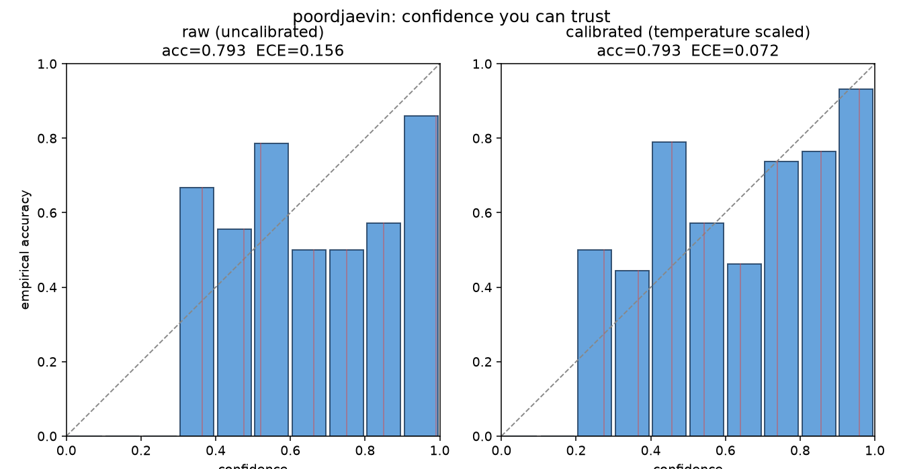
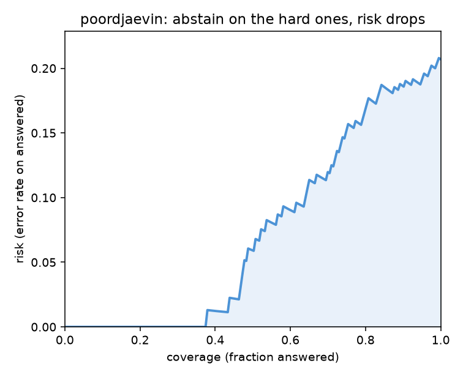

# Results

Every number here is produced by `poorjev eval` on the shipped eval set
(`evalset/tasks.jsonl`, 70 items / 203 labelled decisions). Reproduce with:

```bash
pip install -e ".[local]"
poorjev eval --set evalset/tasks.jsonl
```

The set is small and hand-labelled. It is enough to estimate accuracy and
calibration and to show the direction calibration moves them. It is not a large
benchmark, and we do not claim it is.

## Raw, uncalibrated (local NLI backend)

Backend: `MoritzLaurer/deberta-v3-base-zeroshot-v2.0`, keyless, offline.

| Slice | n | Accuracy | ECE | Brier | AURC |
|---|---:|---:|---:|---:|---:|
| **overall** | 203 | 0.793 | **0.156** | 0.173 | 0.073 |
| action_risk | 60 | 0.900 | 0.101 | 0.100 | 0.025 |
| intent | 19 | 0.895 | 0.191 | 0.150 | 0.053 |
| support_triage | 124 | 0.726 | 0.182 | 0.212 | 0.109 |

Reading this honestly: the model is right about 79% of the time, but its
confidence is off by 0.156 on average (ECE). That gap is the problem poorjev
exists to fix. The raw probabilities out of any classifier, local or LLM, are
not trustworthy as-is.

## Calibrated (temperature scaling + conformal abstention)

Reproduce with:

```bash
poorjev calibrate --set evalset/tasks.jsonl --plots
```

Temperature is fit by 5-fold cross-validation: on each fold T is fit on the
other four and the calibrated ECE is measured on the held-out fold, so the
"after" number is never graded on data it was fit on.

| Metric | Raw | Calibrated | |
|---|---:|---:|---|
| Accuracy | 0.793 | 0.793 | unchanged (temperature is monotonic) |
| **ECE** | **0.156** | **0.072** | **54% lower calibration error** |
| Temperature (mean) | 1.00 | 2.59 | > 1: the model was overconfident, softened |



Left: raw confidences scatter around the diagonal, mostly below it
(overconfident). Right: after temperature scaling the bars hug the diagonal,
predicted confidence now tracks real accuracy.

### Selective prediction

Set a risk budget and abstain below the matching confidence threshold:

| Target risk | Coverage | Threshold |
|---|---:|---:|
| <= 0.10 | 0.64 | 0.735 |

At a 10% error budget the model confidently answers 64% of decisions and
abstains on the rest (the honest "I don't know, escalate" signal). Full curve:



### Per-slice calibration profiles

One global temperature hides slice-level weakness. `--profiles-out` fits one
profile per (task, decision type) on the same 5-fold held-out scheme. Slices
below 30 labelled decisions stay advisory and fall back to the global
calibrator; no profile is graded on the data it was fit on.

```bash
poordjaevin calibrate --set evalset/tasks.jsonl \
    --out calibration.json --profiles-out calibration_profiles.json --plots
```

Dataset digest: `sha256:ae6a1866ce80108b` (203 decisions in
`evalset/tasks.jsonl`).

| Profile | n | Status | T | ECE before -> after | Coverage @ risk <= 0.10 | Observed risk [CI95] |
|---|---:|---|---:|---|---:|---|
| action_risk:noul | 60 | validated | 2.98 | 0.101 -> 0.039 | 1.00 | 0.100 [0.047, 0.202] |
| intent:choice | 19 | advisory (n < 30) | global fallback | - | - | - |
| support_triage:choice | 31 | validated | 1.68 | 0.183 -> 0.154 | 0.03 | 0.000 [0, 0.794] |
| support_triage:noul | 62 | validated | 2.94 | 0.104 -> 0.031 | 1.00 | 0.097 [0.045, 0.196] |
| support_triage:score | 31 | validated | 5.68 | 0.424 -> 0.107 | 0.00 | 0.000 [0, 1.0] |

The pooled `support_triage` coverage of ~0.5 was misleading: `noul` decisions
there are strong (full coverage at target risk) while `choice` and `score`
abstain on almost everything. A validated profile that still abstains on
nearly all inputs is honest but not yet useful; those slices need either
more distinctive hypotheses or a different backend before gating on them.

### Honest notes

- The after-ECE is 0.072, not below 0.05. That is the real cross-validated
  number on a small set; we report it as measured rather than tuning to a
  target. Per-slice profiles (above) now replace the single global scalar
  where they are validated.
- Same eval set caveats as above: small, single-labeller, support flavoured.

## How this compares to Jev, Laya, and von

Everything above is poorjev graded against itself. For an independently
measured comparison against Jev, Laya, and von on this same eval set plus a
public 77-way benchmark (Banking77), see [`crossbench/`](crossbench/) and the
["poorjev vs the field"](README.md#poorjev-vs-the-field) table in the main
README. Short version: poorjev leads the open options on this eval set;
`von` leads the open options on Banking77 (high-cardinality classification);
Jev leads overall.
